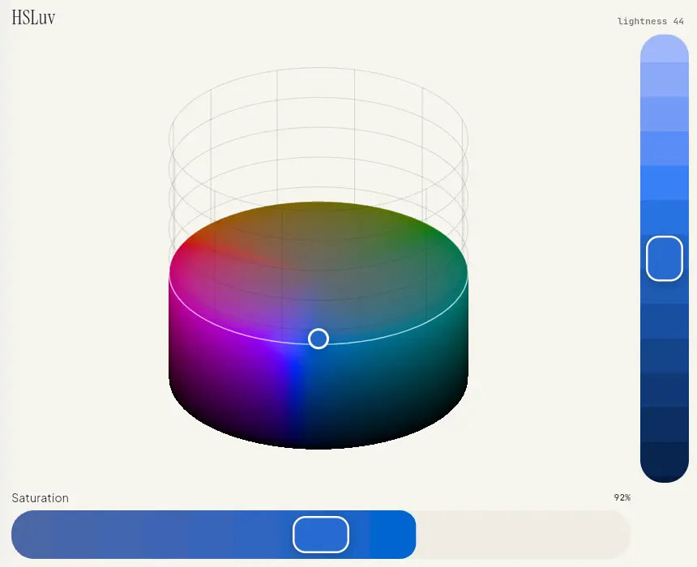
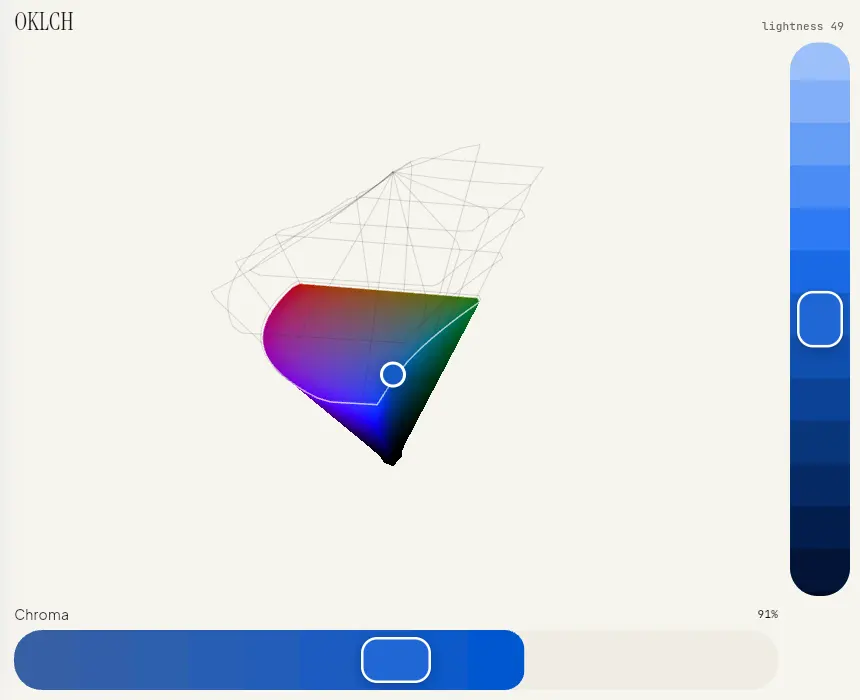
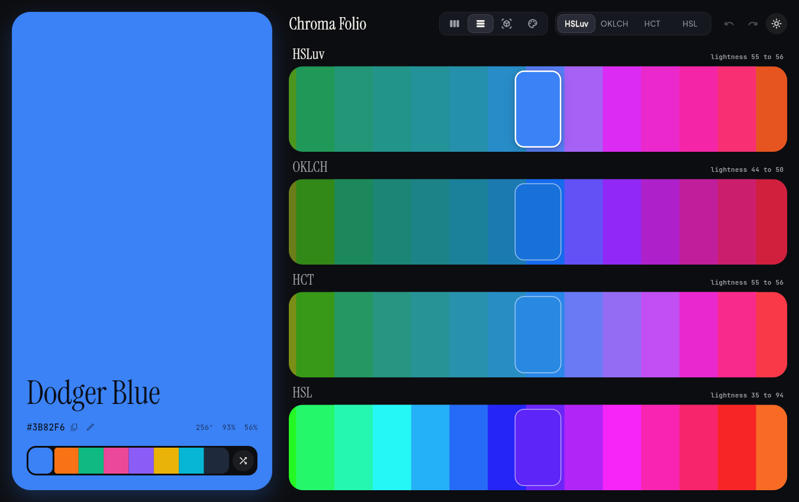

<p align="center">
  
</p>

<h1 align="center">Chroma Folio</h1>

<p align="center"><strong>See the shape of a colour space.</strong></p>

<p align="center">A colour picker for Android and the web. Turn and slice a 3D colour solid, spin the reels to find a colour, then build a palette around it.</p>

<p align="center"><a href="#turn-colour-around">Explore the 3D view</a> · <a href="#run-from-source">Run the app</a> · <a href="#build-a-palette">Copy a palette</a></p>

## Turn colour around

In **Solid**, hue goes around the shape, lightness goes up, and chroma extends outward. Turn the shape with a sideways drag. The reel on the right raises or lowers the cut, and the horizontal reel below adjusts saturation or chroma. You can also tap anywhere on the cut face to pick a colour.

| HSLuv | OKLCH |
| :---: | :---: |
|  |  |

HSLuv's saturation scale gives the solid a cylindrical outline. In OKLCH, the outline shows how much chroma sRGB can reach at each hue and lightness.

## See what a colour space changes

Give four colour spaces the same hue, saturation, and lightness and see how differently they render it. In **Spectrum**, the strips move together so you can compare a single hue across HSLuv, OKLCH, HCT, and HSL. Drag a strip to pick from that space.



## Build a palette

Start with one colour and try its tonal scale or a harmony. Each harmony previews the base colour, two accents, and five supporting shades. Tap one to fill your eight swatches, then drag along the swatch strip to pick a colour to edit.


Copy the tonal scale for Tailwind or export your palette as hex, Flutter code, or CSS variables. For CSS, choose **OKLCH** or **Display P3**. The P3 option expresses the current sRGB colours in Display P3 coordinates.

## Spin the reels

<p align="center">
  
</p>

- **Flick a reel** to spin it, or tap a band to bring it under the lens.
- **Tap a channel value** to enter it exactly. Use the pencil next to the hex code to paste a hex, RGB, or OKLCH colour.
- **Tap the hex code** to copy the current colour. Press **Space** to shuffle the palette, then use **Undo** to go back.

## Run from source

Install Flutter and Chrome.

```sh
git clone https://github.com/bernaferrari/chroma-folio.git
cd chroma-folio
flutter pub get
flutter run -d chrome
```

For Android, start an emulator or connect a device. Use `flutter devices` to find its ID, then run `flutter run -d <device-id>`.

Run `flutter analyze` and `flutter test` to check the project. To build the static web app in `build/web`, run `flutter build web --release`.

Chroma Folio grew out of the [hsluv-dart example](https://github.com/bernaferrari/hsluv-dart) and uses [HSLuv from pub.dev](https://pub.dev/packages/hsluv). [MIT license](LICENSE).
