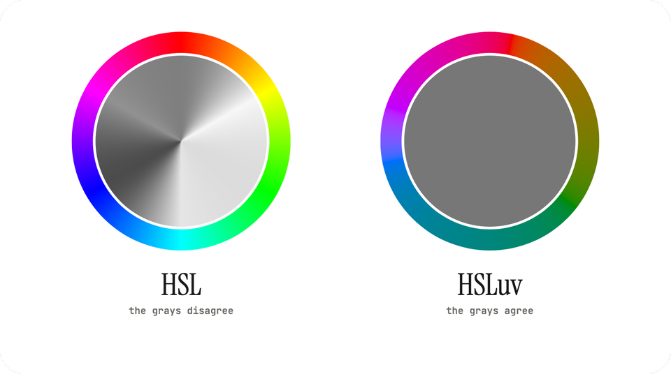

<p align="center">
  
</p>

<h1 align="center">Chroma Folio</h1>

<p align="center"><strong>See the shape of a color space.</strong></p>

<p align="center">Turn and slice a 3D color solid, spin the reels to find a color, then build a palette around it.</p>

<p align="center"><a href="https://bernaferrari.github.io/chroma-folio/"><strong>Try Chroma Folio ↗</strong></a></p>

<p align="center">
  
  <br><sub>Raise the cut from 55% to 85% lightness.</sub>
</p>

## Why HSL lightness lies

Many color pickers use HSL, where lightness comes from a formula rather than from what you see. Both wheels below are set to lightness 50. The center shows the gray that matches each hue's perceived brightness.

<p align="center">
  
</p>

In HSL, yellow comes out almost white and blue comes out dark. HSLuv measures lightness the way eyes see it, so every gray matches. The trade-off is that its yellow turns olive, because no yellow can be both vivid and that dark.

OKLCH and HCT keep lightness steady too. They also measure colorfulness in absolute terms instead of stretching every hue to the edge, so their solids take the lumpy shape of what a screen can actually show. Open **Solid** to turn that shape around: drag sideways to spin it, drag up or down to move the slice, and tap the slice to pick a color.

## See what a color space changes

Give four color spaces the same hue, saturation, and lightness and see how differently they render it. In **Spectrum**, the strips move together so you can compare a single hue across HSLuv, OKLCH, HCT, and HSL. Drag a strip to pick from that space.


## Build a palette

Pick one of twelve **starter palettes**, from fluorescent Riso inks to quiet grays with one loud note, or grow a palette from a single color with its tonal scale or a harmony. Starters have four to eight colors, and harmonies and shuffle keep the size you have. Tap a harmony to fill your palette, then drag along the swatch strip to pick a color to edit.


Copy the tonal scale for Tailwind or export your palette as hex, Flutter code, or CSS variables. For CSS, choose **OKLCH** or **Display P3**. The P3 option expresses the current sRGB colors in Display P3 coordinates.

## Spin the reels

<p align="center">
  
</p>

- **Flick a reel** to spin it, or tap a band to bring it under the lens.
- **Tap a channel value** to enter it exactly. Use the pencil next to the hex code to paste a hex, RGB, or OKLCH color.
- **Tap the hex code** to copy the current color. Press **Space** to shuffle the palette, then use **Undo** to go back.

## Run from source

Install Flutter and Chrome.

```sh
git clone https://github.com/bernaferrari/chroma-folio.git
cd chroma-folio
flutter pub get
flutter run -d chrome
```

Run `flutter analyze` and `flutter test` to check the project. To build the static web app in `build/web`, run `flutter build web --release`.

Chroma Folio grew out of the [hsluv-dart example](https://github.com/bernaferrari/hsluv-dart) and uses [HSLuv from pub.dev](https://pub.dev/packages/hsluv). [MIT license](LICENSE).
