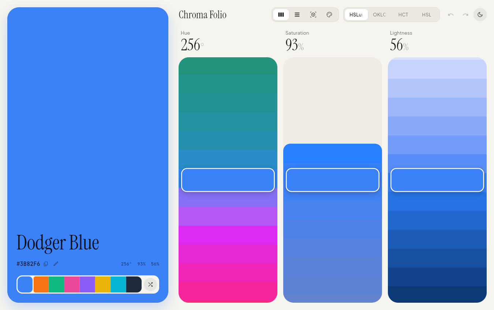
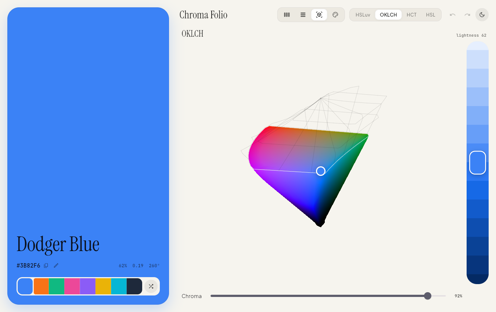

# Chroma Folio

A colour studio you can fling. Spin three colour reels, compare the same hue across four colour spaces, or turn a 3D solid and pick directly from its cut face.



## Four ways to explore colour

| Spectrum | Solid |
| --- | --- |
|  |  |
| Fling the strips together to compare HSLuv, OKLCH, HCT, and HSL. Touch a strip to pick from its colour space. | Drag sideways to turn the solid. Move the lightness reel to raise or lower the cut, then pick a colour on the cut face. Use the horizontal slider to adjust saturation or chroma at the current hue and lightness. |


In **Reels**, drag slowly for control or fling to see where the colour lands. Tap a channel value to enter it exactly. In **Palette**, try a harmony on your eight swatches, copy the tonal scale for Tailwind, or export the palette as hex, CSS variables, or Flutter code.

## Run locally

Install Flutter with Dart 3.13 or newer. The app was verified with Flutter `3.51.0-1.0.pre-56`.

```sh
git clone https://github.com/bernaferrari/chroma-folio.git
cd chroma-folio
flutter pub get
flutter run -d chrome
```

To run on Android, start an emulator or connect a device and select it with `flutter run -d <device-id>`.

Run `flutter analyze` and `flutter test` to check the project. Run `flutter build web --release` to build the static site in `build/web`.

## Credits

Chroma Folio started as the example app in [hsluv-dart](https://github.com/bernaferrari/hsluv-dart). The matching HSLuv package is included under [packages/hsluv](packages/hsluv) so you can build from this checkout.

[MIT license](LICENSE)
